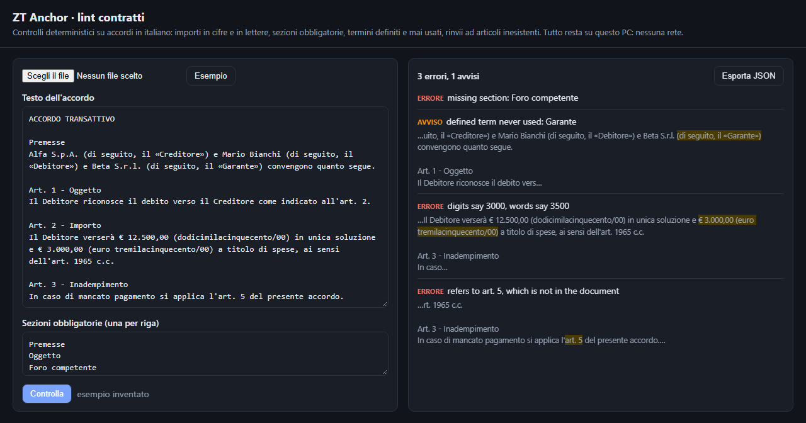

# zt-anchor

[](https://github.com/Giotor84/zt-anchor/actions/workflows/tests.yml) [](LICENSE.md) 

**In italiano:** strumenti Python per l'AI documentale che sa dire «non lo so»: ogni valore estratto è ancorato al testo, i casi incerti vanno a una persona, controlli deterministici sugli accordi italiani (importi in cifre e in lettere, sezioni obbligatorie, rinvii ad articoli).

**Document AI that can say "I don't know".**

LLMs extract fields from contracts, court decisions and letters fast — and sometimes invent them. In legal and
financial work one invented amount or date costs more than all the time saved. *ZT Anchor* is a small Python toolkit that puts the guardrails **in code**, around any model you use (local llama.cpp,
Amazon Bedrock, OpenAI-compatible servers):

| module | what it guarantees |
|---|---|
| `anchor` | every claim points to an **exact span of the source**, with offsets computed in Python, never by the model; invented quotes are caught; the value must be inside the quoted span |
| `abstain` | three outcomes — **accepted / needs review / abstained** — never a silent guess |
| `holdout` | **frozen-holdout** evaluation: sample frozen before running, fingerprint of code and prompts, sample invalidated if you tune the system afterwards; abstentions counted apart from errors |
| `truth` | **truth labels** for reports (`VERIFIED_SYNTHETIC`, `VERIFIED_LIVE`, `VERIFY_LIVE`, …): synthetic results cannot be presented as live ones, verified claims need evidence |
| `structured` | JSON out of chatty answers, schema validation, **retries with the errors fed back** |
| `contract_lint` | deterministic checks for Italian agreements: **amount in digits vs in words**, required sections, unused defined terms, references to missing articles (law citations ignored) |
| `it_normalize` | Italian amounts (`€ 1.234,56`, `€ 351212`), **number words** (`settantaquattromila/00`), dates (`1° marzo 2026`, two-digit years refused), NaN-safe yes/no flags |

No dependencies. Python 3.10+.

## 30-second demo

```bash
git clone https://github.com/Giotor84/zt-anchor && cd zt-anchor
python examples/demo_synthetic.py
```

```
EXTRACTION
  importo        12500            accepted      [191:229]
  rateizzazione                   abstained     [-]        not anchored: not_found
  scadenza       DA VERIFICARE    needs_review  [230:253]  confidence 0.72 below 0.90

CONTRACT LINT
  error   section_missing      missing section: Foro competente
  error   reference_missing    refers to art. 4, which is not in the document
```

The model "found" a 24-instalment plan that is not in the agreement: ZT Anchor refuses it. The deadline is real
but the model was unsure: it goes to a person. Only the amount, quoted verbatim and consistent, is filled.

## Use

```python
from zt_anchor import Claim, Source, check_claims, decide

doc = Source("acc-1", text)
checked = check_claims([Claim("importo", Decimal("12500"), quote_from_model, "acc-1")], [doc])[0]
d = decide("importo", checked.claim.value, confidence=0.97, checked=checked)
d.status      # Status.ACCEPTED / NEEDS_REVIEW / ABSTAINED
d.filled      # the value only when accepted
d.cell()      # value, "DA VERIFICARE" or "" for spreadsheets
```

```python
from zt_anchor import fingerprint, freeze, load_frozen, evaluate

fp = fingerprint(["reader.py", "prompts/extract.md"], {"model": "qwen2.5-14b-q4", "threshold": 0.9})
ids = freeze(all_ids, n=60, seed=2026, system_fingerprint=fp, path="holdout/v1.json")   # BEFORE running
report = evaluate(predictions, human_gold, ids)   # coverage, selective accuracy, wrong ids
```

## Offline page for reviewers



Online copy, rebuilt on every change by `.github/workflows/pages.yml`: <https://giotor84.github.io/zt-anchor/>
(the PDF is read in your browser, nothing is uploaded).

`python web/build.py` builds `web/dist/zt-anchor-lint.html`: one file (≈1.4 MB, PDF.js inlined) that a legal
reviewer opens by double-click, with no installation and no network. Load a PDF or paste the text, list the
required sections, and get the same contract-lint findings as the Python library, highlighted in context and
exportable as JSON. A parity test (`web/test_parity.py`, needs Node.js) keeps the JavaScript and Python rules
aligned.

## Where it comes from

These patterns were built and paid for in production work on Italian legal and credit-recovery documents
(court decisions, settlement agreements, registered-mail receipts, debtor filings), where a wrong field has
legal consequences. This repository is a clean rewrite with synthetic examples only: no client code, no data.

## Known limits

- Thresholds (confidence, fuzzy match) must be set on your own frozen holdout: the defaults are a starting point.
- `contract_lint` and `it_normalize` cover Italian documents only.
- Anchoring proves that a quote exists in the source, not that the model read it correctly: `needs_review` cases still need a person.
- The offline page reads the PDF text layer: scanned PDFs need OCR first.

## Related projects

- [zt-legal-analysis-core](https://github.com/Giotor84/zt-legal-analysis-core) — OCR cascade and rolling synthesis for case files larger than the context
- [zt-legal-graph](https://github.com/Giotor84/zt-legal-graph) — local, source-anchored drafting for Italian civil cases
- [zt-airgap](https://github.com/Giotor84/zt-airgap) — LLM pipelines without internet (SageMaker + Bedrock)
- [zt-backtest](https://github.com/Giotor84/zt-backtest) — honest forecast evaluation with blind windows
- All projects: [github.com/Giotor84](https://github.com/Giotor84)

## License: free for individuals and small companies, paid for larger ones

ZT Anchor is **source-available** under the [PolyForm Small Business License 1.0.0](LICENSE.md):

- **free** for personal use, research, non-profits and companies with **fewer than 100 people and less than
  1 M USD revenue**;
- **larger organisations** (banks, servicers, insurers, large law firms, consultancies) need a
  **[commercial license](COMMERCIAL.md)**, which also includes support and integration help.

Not sure which applies to you? Ask — see [COMMERCIAL.md](COMMERCIAL.md).

## Contributing

Issues and PRs are welcome. Because of the dual licensing, code contributions require agreeing to the
[Contributor License Agreement](CLA.md).
